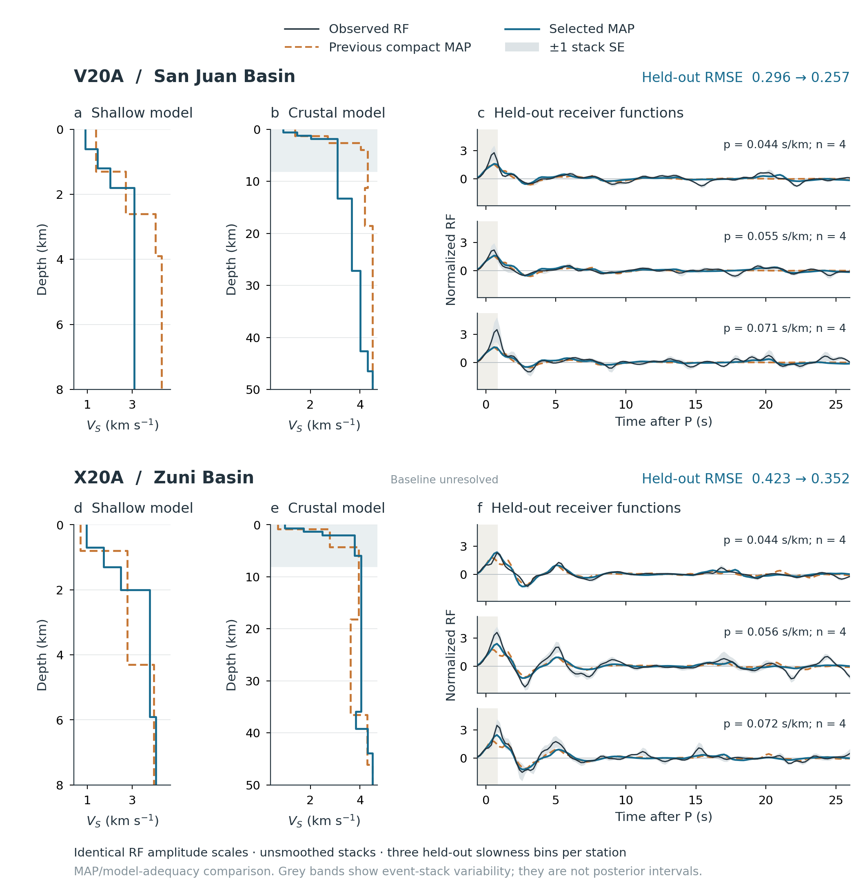

# Flow-assisted HMC receiver-function inversion

**FlowRF** provides a CPU Python API for seismic receiver-function (RF) modeling and Bayesian inversion. A Transformer conditional flow proposes candidate structures; multi-start physical optimization refines their starting points; Metropolis-corrected HMC, DRAM, or Metropolis-within-Gibbs samples the declared physical target.

[中文说明](README.zh-CN.md) · [Installation](docs/installation.md) · [API and input format](docs/api.md) · [Model cards](docs/models.md) · [Reproduction](reproducibility/README.md)

The repository includes **our programs and trained weights**, with the research artifacts isolated in `reproducibility/`. Third-party inversion programs are **not included**. Their methods are cited in [references](docs/references.md). GRTM is an external dependency. There are no CUDA kernels, native solver binaries, accelerator launchers, or remote-compute scripts here.

## Install

Physical inversion currently uses the GRTM community **v0.6.0.dev2 CPU RF preview**: macOS Apple Silicon with Python 3.12, or Linux x86_64 with Python 3.13 and glibc ≥2.28. Neural inference and frozen-array figure reproduction do not require GRTM. Windows physical wheels are not available in this preview.

```bash
git clone https://github.com/cangyeone/flow-assisted-hmc-receiver-function-inversion.git
cd flow-assisted-hmc-receiver-function-inversion
python3.12 -m venv .venv          # macOS; use python3.13 on Linux
source .venv/bin/activate
# Linux: install the CPU PyTorch wheel first:
# python -m pip install torch --index-url https://download.pytorch.org/whl/cpu
python -m pip install '.[plot]'
flowrf install-grtm              # external, version/hash-pinned community wheel
flowrf doctor
flowrf demo --output outputs/demo
```

Or run `PYTHON_BIN=python3.12 ./install.sh` on macOS / `PYTHON_BIN=python3.13 ./install.sh` on Linux. The demo is deliberately short and reports provisional chains; it is an installation check, not a convergence or accuracy benchmark.

## Use the Python API

```python
from flowrf import forward, RFData, NeuralModels, RFInverter

# Rows: top (km), Vp (km/s), Vs (km/s), density (g/cm³).
# The last row is the mantle halfspace. Optional columns 5–6: Qp, Qs.
layers = [[0, 3.6, 2.0, 2.5],
          [2, 6.5, 6.5 / 1.78, 2.8],
          [35, 8.0, 4.5, 3.3]]
p = [0.044, 0.059, 0.075]       # ray slowness, s/km
rf = forward(layers, p, gaussians=[1.0, 2.5, 4.0])  # differentiable CPU tensor

# Use your measured, P-normalized RFs instead of this synthetic example.
data = RFData(rf.detach().numpy()[0], p, gaussians=(1.0, 2.5, 4.0), sigma=0.03)
net = NeuralModels()             # bundled global-v2 weights, loaded on CPU
candidates = net.propose(data, draws=256)
emulator = net.generate(layers, p, draws=128)

result = RFInverter().invert(data, initializer="flow", sampler="hmc",
                            starts=16, chains=4, steps=3000, burn_in=1000)
result.save("outputs/my-inversion")
result.plot("outputs/my-inversion/rf-fit.png")
print(result.summary["status"])
```

Use `initializer="sobol"` when the neural input format is unavailable. **Do not synthesize missing RF bands from the emulator** to condition the released flow. Physical modeling accepts arbitrary layer counts; the released flow has learned support for **2–16 finite layers**. The supplied physical inversion families are a compact sediment/crust model and a configurable crustal velocity-control model. Candidate structures are projected to the selected physical family before optimization; flow density is never multiplied into the posterior.

```bash
flowrf invert my-rfs.npz --initializer sobol --sampler hmc --output outputs/station
flowrf invert my-multiband-rfs.npz --initializer flow --controls 4 --output outputs/controls
flowrf propose my-multiband-rfs.npz --draws 256 --output outputs/candidates.npz
flowrf forward examples/model.json --output outputs/physical-rf.npz
```

See [input conventions and priors](docs/api.md). Posterior files retain rejected states, warmup, likelihood values, diagnostics, seeds, parameter bounds, and timing. A fit with failed diagnostics remains explicitly provisional.

## What the evidence supports

Good initial candidates can reduce time spent reaching a useful basin of attraction. They do not introduce new observations or guarantee a more accurate final posterior. The archived synthetic study found improved basin initialization and less optimization work, with broadly similar final accuracy; its no-sediment transfer failure is retained. The field archive contains 42 stations, including unresolved chains and boundary solutions. Better waveform fit alone does not establish independent geological accuracy or calibrated coverage.

The forward Transformer is an approximate RF emulator with bounded heteroscedastic standard deviations. It is not the default physical likelihood. Experimental discriminator and observation-specific likelihood weights are retained for inspection in `reproducibility/models/`; they are not used as default posterior constraints.

## Archived real-data example



This frozen example compares physical model families on held-out RFs. It does not measure the benefit of flow initialization; the unresolved baseline and stack variability are retained. Rebuild it with `python reproducibility/scripts/build_field_figures.py`.

## Repository layout

| Location | Purpose |
|---|---|
| `src/flowrf/` | Reusable CPU API, CLI, model architectures and production weights |
| `examples/` | Small runnable examples |
| `tests/` | Physics gradients, known-target sampling, neural interfaces and publication boundary checks |
| `docs/` | English usage, priors, model cards, citations and dependency guidance |
| `reproducibility/` | Frozen research data/results, CPU research programs, configs, experimental models, provenance and figure reconstruction |

## GRTM and RF quality control

[GRTM community](https://github.com/cangyeone/seismicx-grtm-community) supplies the differentiable physical solver and Bayesian sampling primitives. `flowrf install-grtm` installs the published CPU RF preview; a local private source checkout is unnecessary. The ordinary stable GRTM wheel does not contain these new RF interfaces.

[DNN-RFQC community](https://github.com/cangyeone/dnn-rfqc-community) is a separate optional package for screening RF quality before stacking/inversion. It does not replace GRTM. Install and use it according to its own README; do not pass QC scores as extra likelihood factors without a separately validated statistical model.

## License and citation

Our original FlowRF code, documentation and released model weights use [GNU GPL version 3 only](LICENSE) (`GPL-3.0-only`); see [NOTICE](NOTICE). This applies from version 0.1.1. The previously published version 0.1.0 retains its MIT license. External GRTM retains its [research/noncommercial license](https://github.com/cangyeone/seismicx-grtm-community/blob/main/LICENSE); it is not relicensed by this repository. Observational and basin-map sources retain their own attribution; see [third-party notices](THIRD_PARTY_NOTICES.md). The complete physical stack therefore retains GRTM's research-use terms.

Use [CITATION.cff](CITATION.cff) to cite this software, and cite the relevant RF, HMC, flow and comparison-method papers in [docs/references.md](docs/references.md). This software release does not imply that the manuscript has been accepted or independently validated.
